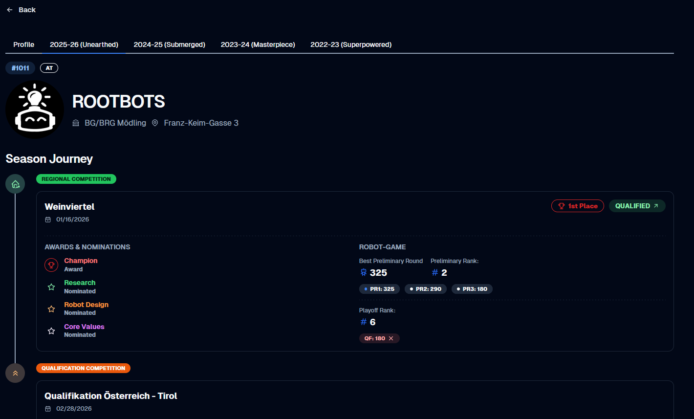

# Challenge Team Hub 🤖🏆

🌍 **Live Platform:** [challengeteamhub.org](https://challengeteamhub.org)



Challenge Team Hub (CT Hub) is a full-stack platform for publishing and exploring FIRST LEGO League competition data. It combines a Spring Boot backend with a React frontend to surface seasons, competitions, team profiles, robot game leaderboards, awards, and search in a single web application.

The backend also includes scraper and synchronization workflows for importing official event data, while the frontend provides a public-facing UI for browsing current and historical results.

## Why It Is Useful

- Tracks FLL seasons, competitions, teams, placements, awards, and robot game results in one place.
- Exposes a public leaderboard and competition detail pages for quick result lookup.
- Supports searchable team and competition discovery from the UI.
- Includes authenticated admin capabilities for login and scraper-triggered synchronization.
- Packages the frontend into the Spring Boot application for a single deployable artifact.

## Architecture

```text
CT Hub
|- src/main/java          Spring Boot API, security, persistence, scraping, scheduling
|- src/main/resources     Application profiles and packaged static assets
|- frontend/              React + TypeScript + Vite application
|- docker-compose.yml     Local PostgreSQL service
|- pom.xml                Maven build that also installs/builds the frontend
```

## Tech Stack

### Backend

- Java 21
- Spring Boot 4.0.1
- Spring Web MVC
- Spring Security with session auth and remember-me cookies
- Spring Data JPA
- PostgreSQL for local and production data
- H2 available as a dependency for lightweight environments
- SpringDoc OpenAPI / Swagger UI
- Jsoup-based scraping services

### Frontend

- React 18
- TypeScript
- Vite
- Mantine UI
- React Router
- Axios
- i18next

## Main Features

- Global robot game leaderboard at `/leaderboard`
- Competition detail pages at `/competition/:seasonId/:urlPart`
- Season-specific team detail pages at `/team/:seasonId/:fllId`
- Public team profile pages at `/:teamProfileUrl` and `/:teamProfileUrl/:seasonId`
- Global search across teams, competitions, profiles, and seasons
- Session-based login at `/login`, e-mail-only self-service registration at `/register`, password reset, and passwordless login links (see [Authentication & Registration](#authentication--registration))
- Admin-only scraper endpoints for full sync, quick sync, and per-competition refresh
- Provider-agnostic outbound mail (logging adapter for local dev, ZeptoMail in production) with a transactional outbox, retry/backoff, and Thymeleaf-rendered templates

## Getting Started

### Prerequisites

- Java 21
- Maven 3.9+ or the included Maven wrapper
- Node.js 24+ for standalone frontend work
- Docker Desktop or another Docker runtime for local PostgreSQL

### 1. Start PostgreSQL

From the repository root:

```bash
docker-compose up -d
```

This starts PostgreSQL 16 on `localhost:5432` with the default local database:

- Database: `ct_hub`
- User: `dev`
- Password: `dev`

### 2. Run the Backend

Use the local Spring profile so CORS, SQL logging, and seeded admin credentials match local development.

Windows:

```powershell
.\mvnw.cmd spring-boot:run "-Dspring-boot.run.profiles=local"
```

macOS/Linux:

```bash
./mvnw spring-boot:run -Dspring-boot.run.profiles=local
```

The API will be available at `http://localhost:8080`.

On first startup, the app seeds an admin user if the user table is empty:

- Email: `admin@challengeteamhub.org`
- Password in `local` profile: `admin123`

### 3. Run the Frontend

From `frontend/`:

```bash
npm install
npm run dev
```

The Vite dev server runs on `http://localhost:5173` and proxies `/api` requests to `http://localhost:8080`.

### 4. Build the Full Application

The Maven build installs Node, runs the frontend build, and copies the frontend output into the Spring Boot JAR.

Windows:

```powershell
.\mvnw.cmd clean package
```

macOS/Linux:

```bash
./mvnw clean package
```

Run the packaged application:

```bash
java -jar target/backend-0.0.1-SNAPSHOT.jar
```

## Environment and Profiles

The repository uses Spring profiles and environment variables for local and production environments.

### Local profile

Configured in `src/main/resources/application-local.yaml`:

- Allowed frontend origin: `http://localhost:5173`
- Remember-me key: `local-remember-me-key`
- Seed admin password: `admin123`

### Production profile

Configured in `src/main/resources/application-prod.yaml` and `src/main/resources/application.yaml`.

Expected environment variables include:

- `PGHOST`
- `PGPORT`
- `PGDATABASE`
- `PGUSER`
- `PGPASSWORD`
- `REMEMBER_ME_KEY`
- `ADMIN_PASSWORD`
- `ZEPTOMAIL_TOKEN` (required when `app.mail.provider=zeptomail`, used in production)

## Common Development Commands

From the repository root:

```bash
docker-compose up -d
./mvnw test
./mvnw clean package
```

On Windows, replace `./mvnw` with `.\\mvnw.cmd`.

From `frontend/`:

```bash
npm install
npm run dev
npm run build
npm run lint
npm run gen:api
```

`npm run gen:api` regenerates the typed client from `http://localhost:8080/v3/api-docs`.

## Usage Notes

- Public pages are available without logging in.
- The frontend checks the current session on startup via `/api/auth/me`.
- Swagger UI is available after the backend starts at `http://localhost:8080/swagger-ui.html`.
- In production, scheduled scraping runs hourly for quick result syncs and nightly for full synchronization.

## Authentication & Registration

Authentication is session-based (Spring Security, remember-me cookie). The registration flow is split into
small steps so that a user only ever fills in one thing at a time.

### Flow

1. `/register` asks for **nothing but an e-mail address**. The UI sends the currently selected interface
   language as `locale`, so all follow-up mails are localized to what the user actually picked (not to the
   `Accept-Language` header).
2. The backend returns an opaque `registrationId` and enqueues a confirmation mail. If the address is already
   registered it returns `ALREADY_REGISTERED` and the frontend shows an inline "log in instead" hint. This is a
   deliberate, *localized* enumeration tradeoff — `forgot-password`, `login-link` and `resend-verification`
   remain enumeration-safe and always answer generically.
3. The browser lands on `/registration-pending`, **displays a two-digit confirmation number**, and polls
   `GET /api/auth/registration-status` every 3 s. **The polling endpoint never signs anybody in.**
4. Opening the e-mailed link shows that number among three options (see *Cross-device confirmation* below),
   plus *Continue on this device instead* and *That wasn't me*.
5. A correct pick verifies the address and lets the waiting browser claim its session via
   `POST /api/auth/registration-claim`. The account now exists even if the user stops here — it is simply
   marked incomplete.
6. `/complete-profile` collects first/last name (**required**) and a password (**optional**). The welcome mail
   is sent on first profile completion, not on verification.

### Cross-device confirmation

Registering on a laptop but opening the link on a phone used to strand the user on the wrong device. Instead
of signing the phone in, the link asks *"did you sign up?"* and offers three two-digit numbers; picking the
one shown on the laptop hands the session back there.

The number is **not a secret** — a random pick succeeds one time in three. What it buys is *deliberation*:
somebody who never started a registration has to stop and think, with *That wasn't me* sitting right next to
the choices. The actual protection is the surrounding mechanics:

- A **wrong pick burns the link** but leaves the attempt alive, so an honest misclick costs one resend rather
  than a restart. There is never a second pick on the same link — three options with two guesses would be a
  weaker gate than the one being put up.
- `RegistrationChallenge.MAX_ATTEMPTS` (3) wrong picks cancel the attempt outright.
- *That wasn't me* cancels the attempt and **deletes the account** when it is still pristine (unverified, no
  password, no profile), then blocks that address from being registered again for an hour. This is a genuine
  improvement over the mainstream "sign up with a password, verify later" flow, where an attacker already
  holds a working account under someone else's address.
- *Continue on this device instead* is the plain `POST /verify-email` path. It is not a bypass: whoever holds
  the e-mailed link owns the mailbox, so signing them in was always legitimate. Any browser still waiting is
  told to stand down (`CLAIMED_ELSEWHERE`).
- The prompt is **skipped entirely** when the `ct_registration` cookie shows the link was opened in the
  browser that started the registration, or when no browser is waiting at all (a resend from the login
  screen, say) — in both cases there is no session to hand over.

The three numbers are derived deterministically from the attempt's token hash, so reloading the link always
shows the same options, and they are guaranteed to differ in **both** digit positions. That single rule rules
out transpositions (69/96), shared-digit twins (66/69) and off-by-one neighbours (47/48), so a legitimate user
never loses their registration to a glance-alike.

### Incomplete profiles

Users without a completed profile are allowed to log in but not to use the app. A real name is mandatory, so
`ProfileCompletionInterceptor` rejects every non-exempt `/api/**` call with HTTP 403
`{"code":"PROFILE_INCOMPLETE"}` — reads included; only the auth endpoints needed to finish or abandon the
flow (plus CORS preflights) are exempt. The frontend's axios interceptor turns that into a redirect to
`/complete-profile`.

### Passwordless login

Because the password is optional, an account may have none. `POST /api/auth/login` then answers 403
`NO_PASSWORD_SET`, and the user can request a one-time login link via `POST /api/auth/login-link`. Login links
are available to every account, not just passwordless ones.

### Endpoints (`/api/auth`)

| Endpoint | Purpose |
| --- | --- |
| `POST /login`, `POST /logout`, `GET /me` | Classic session login / logout / current user |
| `POST /register` | Start registration (e-mail + locale) → `PENDING` or `ALREADY_REGISTERED` |
| `GET /registration-status?registrationId=` | Poll: `PENDING` / `AWAITING_CONFIRMATION` / `VERIFIED` / `CLAIMED_ELSEWHERE` / `CANCELLED` / `UNKNOWN` — never signs in |
| `GET /verification-challenge?token=` | What the opening device should be asked: `CHALLENGE` / `SAME_BROWSER` / `NO_CHALLENGE` / `INVALID` |
| `POST /verification-confirm` | Answer the number challenge; a wrong pick burns the link (400 `CONFIRMATION_MISMATCH`) |
| `POST /verification-reject` | "That wasn't me" — cancel the attempt and remove a pristine account |
| `POST /registration-claim` | The waiting browser exchanges its handle for a session once confirmed |
| `POST /verify-email` | "Continue on this device instead": consume the token, verify and sign in |
| `POST /resend-verification` | Re-send the confirmation mail (rate limited, generic response) |
| `POST /complete-profile` | Set name and optionally a password |
| `POST /forgot-password` / `POST /reset-password` | Password reset; reset signs the user in |
| `POST /login-link` / `POST /login-link/consume` | Request and consume a passwordless login link |

Error responses carry a stable `code`: `ACCOUNT_NOT_VERIFIED`, `NO_PASSWORD_SET`, `TOKEN_INVALID`,
`CONFIRMATION_MISMATCH`, `RATE_LIMITED`, `PROFILE_INCOMPLETE`, `VALIDATION_FAILED`, `UNAUTHENTICATED`,
`AUTHENTICATION_FAILED`.

All token-issuing endpoints are rate limited (10/h per IP, 3/h per e-mail address).

## Outbound Mail

Registration, e-mail verification, and related notifications are sent through a provider-agnostic mail module (`org.cthub.backend.mail`):

- Configuration lives under `app.mail.*` in `application.yaml` / `application-<profile>.yaml` (provider, from-address, outbox polling, ZeptoMail credentials).
- The `local` and `dev` profiles default to `app.mail.provider: logging`, which logs rendered e-mails instead of sending them — no external credentials are required for local development.
- Production uses `app.mail.provider: zeptomail`, which requires the `ZEPTOMAIL_TOKEN` environment variable.
- Mail is never sent synchronously from request threads: services enqueue entries into the `mail_outbox` table (Flyway `V6`), and a scheduled `MailDispatcher` claims and sends due batches with retry/backoff.
- **Safety nets against accidentally mailing real people from a non-production environment:**
  - `app.mail.redirect-all-to` — when set, *every* mail goes to that one address instead of the real recipient (cc/bcc are dropped).
  - `app.mail.allowed-recipients` — when non-empty, only matching recipients are handed to the provider; everything else is marked `CANCELLED` in the outbox and logged. It is matched against the **original** recipient, *before* `redirect-all-to` rewrites it, so you can keep a real ZeptoMail token configured locally and still only receive mail that was genuinely addressed to you — throwaway test addresses are dropped. Entries may be full addresses (`me@example.org`) or whole domains (`@example.org`). Leave empty in production.
- HTML/text templates are rendered with a dedicated Thymeleaf engine (`mail/templates/`, see `MailAutoConfig`) — unrelated to the frontend's web templates.
- Admin-only inspection endpoints for the outbox are available under `/api/admin/mail`.

## Where To Get Help

- Check the OpenAPI UI at `http://localhost:8080/swagger-ui.html` for the current API surface.
- Review [HELP.md](HELP.md) for Spring Boot reference material.
- Use the repository issue tracker in your Git hosting platform for bugs, regressions, and feature requests.

## Maintainer

Developed and maintained by Sebastian Schreitter.