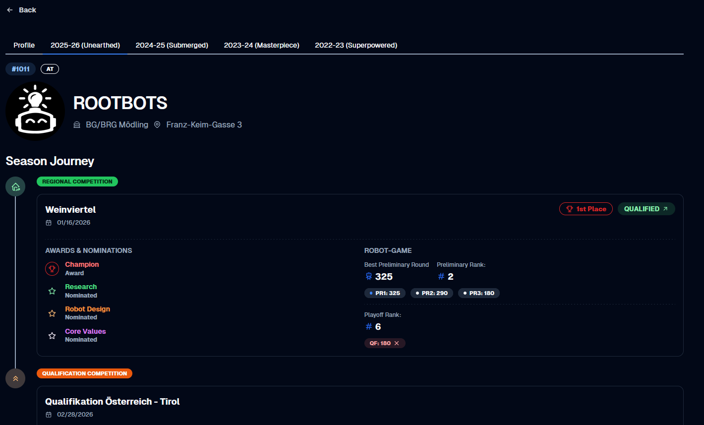

# Challenge Team Hub 🤖🏆

🌍 **Live Platform:** [challengeteamhub.org](https://challengeteamhub.org)



Challenge Team Hub (CT Hub) is a full-stack platform for publishing and exploring FIRST LEGO League competition data. It combines a Spring Boot backend with a React frontend to surface seasons, competitions, team profiles, robot game leaderboards, awards, and search in a single web application.

The backend also includes scraper and synchronization workflows for importing official event data, while the frontend provides a public-facing UI for browsing current and historical results.

## Why It Is Useful

- Tracks FLL seasons, competitions, teams, placements, awards, and robot game results in one place.
- Exposes a public leaderboard and competition detail pages for quick result lookup.
- Supports searchable team and competition discovery from the UI.
- Includes authenticated admin capabilities for login and scraper-triggered synchronization.
- Packages the frontend into the Spring Boot application for a single deployable artifact.

## Architecture

```text
CT Hub
|- src/main/java          Spring Boot API, security, persistence, scraping, scheduling
|- src/main/resources     Application profiles and packaged static assets
|- frontend/              React + TypeScript + Vite application
|- docker-compose.yml     Local PostgreSQL service
|- pom.xml                Maven build that also installs/builds the frontend
```

## Tech Stack

### Backend

- Java 21
- Spring Boot 4.0.1
- Spring Web MVC
- Spring Security with 90-day rotating refresh-token sessions, passkeys (WebAuthn), optional password + TOTP
- Spring Data JPA
- PostgreSQL for local and production data
- H2 available as a dependency for lightweight environments
- SpringDoc OpenAPI / Swagger UI
- Jsoup-based scraping services

### Frontend

- React 18
- TypeScript
- Vite
- Mantine UI
- React Router
- Axios
- i18next

## Main Features

- Global robot game leaderboard at `/leaderboard`
- Competition detail pages at `/competition/:seasonId/:urlPart`
- Season-specific team detail pages at `/team/:seasonId/:fllId`
- Public team profile pages at `/:teamProfileUrl` and `/:teamProfileUrl/:seasonId`
- Global search across teams, competitions, profiles, and seasons
- Session-based login at `/login`, e-mail-only self-service registration at `/register`, password reset, and passwordless login links (see [Authentication & Registration](#authentication--registration))
- Admin-only scraper endpoints for full sync, quick sync, and per-competition refresh
- Provider-agnostic outbound mail (logging adapter for local dev, ZeptoMail in production) with a transactional outbox, retry/backoff, and Thymeleaf-rendered templates

## Getting Started

### Prerequisites

- Java 21
- Maven 3.9+ or the included Maven wrapper
- Node.js 24+ for standalone frontend work
- Docker Desktop or another Docker runtime for local PostgreSQL

### 1. Start PostgreSQL

From the repository root:

```bash
docker-compose up -d
```

This starts PostgreSQL 16 on `localhost:5432` with the default local database:

- Database: `ct_hub`
- User: `dev`
- Password: `dev`

### 2. Run the Backend

Use the local Spring profile so CORS, SQL logging, and seeded admin credentials match local development.

Windows:

```powershell
.\mvnw.cmd spring-boot:run "-Dspring-boot.run.profiles=local"
```

macOS/Linux:

```bash
./mvnw spring-boot:run -Dspring-boot.run.profiles=local
```

The API will be available at `http://localhost:8080`.

On first startup, the app seeds an admin user if the user table is empty:

- Email: `admin@challengeteamhub.org`
- Password in `local` profile: `admin123`

### 3. Run the Frontend

From `frontend/`:

```bash
npm install
npm run dev
```

The Vite dev server runs on `http://localhost:5173` and proxies `/api` requests to `http://localhost:8080`.

### 4. Build the Full Application

The Maven build installs Node, runs the frontend build, and copies the frontend output into the Spring Boot JAR.

Windows:

```powershell
.\mvnw.cmd clean package
```

macOS/Linux:

```bash
./mvnw clean package
```

Run the packaged application:

```bash
java -jar target/backend-0.0.1-SNAPSHOT.jar
```

## Environment and Profiles

The repository uses Spring profiles and environment variables for local and production environments.

### Local profile

Configured in `src/main/resources/application-local.yaml`:

- Allowed frontend origin: `http://localhost:5173`
- Seed admin password: `admin123`

### Production profile

Configured in `src/main/resources/application-prod.yaml` and `src/main/resources/application.yaml`.

Expected environment variables include:

- `PGHOST`
- `PGPORT`
- `PGDATABASE`
- `PGUSER`
- `PGPASSWORD`
- `ADMIN_PASSWORD`
- `ZEPTOMAIL_TOKEN` (required when `app.mail.provider=zeptomail`, used in production)
- `TOTP_ENCRYPTION_KEY` (optional; base64 32-byte AES key, e.g. `openssl rand -base64 32`. Without it, authenticator apps are disabled. Changing it invalidates every enrolled authenticator app)

## Common Development Commands

From the repository root:

```bash
docker-compose up -d
./mvnw test
./mvnw clean package
```

On Windows, replace `./mvnw` with `.\\mvnw.cmd`.

From `frontend/`:

```bash
npm install
npm run dev
npm run build
npm run lint
npm run gen:api
```

`npm run gen:api` regenerates the typed client from `http://localhost:8080/v3/api-docs`.

## Usage Notes

- Public pages are available without logging in.
- The frontend checks the current session on startup via `/api/auth/me`.
- Swagger UI is available after the backend starts at `http://localhost:8080/swagger-ui.html`.
- In production, scheduled scraping runs hourly for quick result syncs and nightly for full synchronization.

## Authentication & Registration

There is no separate registration: `/login` asks only for an e-mail address (`autocomplete="username webauthn"`),
and the response never reveals whether an account exists. An unknown address simply goes through the
verification flow, and the account is created when that flow completes.

### Login waterfall

1. **Passkey autofill** (WebAuthn conditional UI) runs while the e-mail field is focused, so a recognised
   passkey signs in with one tap.
2. `POST /api/auth/identify` returns which methods to offer, with an identical response shape for known and
   unknown addresses. If the account has passkeys, the passkey prompt comes first.
3. If the user has set a **password**, it is offered next. When TOTP is also enabled, it is the **second
   factor** after the password. TOTP is never a standalone login factor, because six digits carry too little
   entropy.
4. The default fallback, and always available via *Use push / e-mail link instead*, is the **number-matching
   challenge** below.

### Number-matching challenge (`auth/attempt`)

`POST /api/auth/attempts` creates a `LoginAttempt` (TTL 15 min) and binds it to the initiating browser ("browser
A") with an HttpOnly `ct_attempt` nonce cookie. Browser A shows the target number out of three
(`LoginChallenge`; all three are pairwise distinct in **both** digit positions) and polls
`GET /attempts/current`.

- **Push:** every live push subscription of the user's *other* sessions receives a notification. Tapping it
  opens `/auth/approve/:attemptId`, which shows the initiating device and the three numbers and needs that
  PWA's authenticated session. The endpoint of browser A's own subscription is excluded, and that orphaned
  subscription is deleted.
- **E-mail:** the magic link is sent immediately when there is no push target, and otherwise after 15 s unless
  the push was opened. Browser A also offers *Send link via e-mail* (30 s cooldown) and uses neutral wording
  ("tap the number on your other device **or** use the e-mail link").
- **`GET` never mutates state.** `GET /link` only describes the link, so mail scanners can prefetch it freely.
  All state changes are `POST`.
- **Same browser** (the nonce cookie matches): `POST /link/complete` signs in without asking for a number.
- **Other browser / device / WebView:** the three numbers approve browser A (`POST /link/approve`).
  *Log in on this browser instead* (`POST /link/claim-here`) cancels A's attempt (`CLAIMED_ELSEWHERE`) and
  signs in the current browser. *That wasn't me* rejects the attempt.
- **A correct number** marks the attempt `APPROVED`. Browser A redeems it with
  `POST /attempts/current/complete` within a 2-minute pickup grace, and a silent `DISMISS` push closes the
  notification everywhere else.
- **A wrong number** invalidates the whole attempt on every device (`REJECTED`). Polling endpoints never sign
  anybody in; only browser A, holding the nonce cookie, can redeem an approval.

Statuses: `PENDING`, `APPROVED`, `COMPLETED`, `CLAIMED_ELSEWHERE`, `REJECTED`, `CANCELLED`. Purposes: `LOGIN`,
`STEP_UP`.

### Sessions (`auth/session`)

- Every sign-in creates an `AuthSession` that lives for 90 days, with no "remember me" option. The short-lived
  access session is the servlet HTTP session. The long-lived credential is a **rotating refresh token** in the
  HttpOnly, Secure, SameSite=Lax `__Host-ct_refresh` cookie (`ct_refresh` when `app.security.cookie-secure=false`
  locally).
- When there is no HTTP session, `SessionAuthenticationFilter` rotates the refresh token. Replaying an
  already-rotated token **revokes the whole session family**.
- **Grace for parallel tabs:** a token rotated less than 30 s ago, whose direct successor is still the live
  head, authenticates *that request only* from the session. No new token is issued, so each rotation has
  exactly one successor.
- **Push subscriptions belong to sessions, not users.** Revoking or expiring a session (`AuthSessionRevokedEvent`)
  removes its subscriptions. Subscriptions that answer 404/410 are deleted.
- **Re-enabling push after a new sign-in:** logging out drops the device's subscription. If notification
  permission was already granted, the frontend resubscribes the device silently after the next sign-in
  (`localStorage` key `cthub.push.resume`). The prompt banner snoozes for 7 days only when the user chooses
  *Not now*.
- **Nudges to install the app** (`features/pwa`): on mobile, `InstallBanner` offers a one-tap install when the
  browser exposes `beforeinstallprompt`, and step-by-step instructions on iOS Safari or when the site is opened
  via `/?install=1`. On desktop, signed-in users without a mobile push device get a QR code that opens the
  install link on their phone. The account security page shows the push/app status as a sign-in method
  (`AppPushCard`).

### Credentials & step-up

- **Passkeys:** multiple per user, synced or device-bound (`auth/webauthn`). After a challenge login on a device
  without one, a dismissible banner suggests registering one.
- **Password (optional):** 12–64 characters, no composition rules, rejected if found in Have I Been Pwned (only a
  5-character SHA-1 prefix is sent).
- **TOTP (optional, RFC 6238):** QR enrolment, which needs a password. It is used as a second factor and for
  step-up.
- **Step-up:** endpoints marked `@RequiresStepUp` need a verification within the last 10 minutes on the current
  session, otherwise they return 403 `STEP_UP_REQUIRED`. Verification can be a passkey, TOTP, or a `STEP_UP`
  challenge. The axios interceptor opens the step-up modal and retries once.
  - **Protected:** password set/remove, all TOTP changes, adding/deleting passkeys, changing e-mail (confirmed
    via an `EMAIL_CHANGE` link to the new address), revoking other sessions, and deleting the account.

### Incomplete profiles

Accounts exist from the moment the e-mail is verified. `/complete-profile` then collects the first and last
name. `ProfileCompletionInterceptor` rejects every non-`/api/auth/` call with 403 `PROFILE_INCOMPLETE` (reads
included; CORS preflights are exempt), and the frontend redirects to `/complete-profile`. The welcome mail is
sent on first profile completion.

### Endpoints

| Endpoint | Purpose |
| --- | --- |
| `GET /api/auth/me`, `POST /api/auth/logout` | Current user / revoke the current session |
| `POST /api/auth/identify` | E-mail step: which methods to offer (enumeration-safe) |
| `POST /api/auth/login/password`, `POST /api/auth/login/password/totp` | Password login, optionally followed by TOTP |
| `POST /api/auth/passkey/options`, `POST /api/auth/passkey/login` | Passkey login (also used for autofill) |
| `POST /api/auth/attempts`, `GET/DELETE /api/auth/attempts/current`, `POST .../complete`, `POST .../email` | Browser A side of the challenge |
| `GET /api/auth/link`, `POST /api/auth/link/{opened,complete,approve,claim-here,reject}` | E-mail link side |
| `GET /api/auth/approvals/{id}`, `POST /api/auth/approvals/{id}/{opened,approve,reject}` | Push approval side (signed-in PWA) |
| `POST /api/auth/complete-profile` | Set the name |
| `/api/auth/step-up/{methods,totp,passkey/options,passkey,challenge}` | Step-up verification |
| `/api/account/{security,password,totp,passkeys,email,sessions}`, `DELETE /api/account` | Account & security settings |

Password, TOTP, passkey, challenge and mail-triggering endpoints are rate limited per IP, address and/or user.

## Outbound Mail

Registration, e-mail verification, and related notifications are sent through a provider-agnostic mail module (`org.cthub.backend.mail`):

- Configuration lives under `app.mail.*` in `application.yaml` / `application-<profile>.yaml` (provider, from-address, outbox polling, ZeptoMail credentials).
- The `local` and `dev` profiles default to `app.mail.provider: logging`, which logs rendered e-mails instead of sending them — no external credentials are required for local development.
- Production uses `app.mail.provider: zeptomail`, which requires the `ZEPTOMAIL_TOKEN` environment variable.
- Mail is never sent synchronously from request threads: services enqueue entries into the `mail_outbox` table (Flyway `V6`), and a scheduled `MailDispatcher` claims and sends due batches with retry/backoff.
- **Safety nets against accidentally mailing real people from a non-production environment:**
  - `app.mail.redirect-all-to` — when set, *every* mail goes to that one address instead of the real recipient (cc/bcc are dropped).
  - `app.mail.allowed-recipients` — when non-empty, only matching recipients are handed to the provider; everything else is marked `CANCELLED` in the outbox and logged. It is matched against the **original** recipient, *before* `redirect-all-to` rewrites it, so you can keep a real ZeptoMail token configured locally and still only receive mail that was genuinely addressed to you — throwaway test addresses are dropped. Entries may be full addresses (`me@example.org`) or whole domains (`@example.org`). Leave empty in production.
- HTML/text templates are rendered with a dedicated Thymeleaf engine (`mail/templates/`, see `MailAutoConfig`) — unrelated to the frontend's web templates.
- Admin-only inspection endpoints for the outbox are available under `/api/admin/mail`.

## Where To Get Help

- Check the OpenAPI UI at `http://localhost:8080/swagger-ui.html` for the current API surface.
- Review [HELP.md](HELP.md) for Spring Boot reference material.
- Use the repository issue tracker in your Git hosting platform for bugs, regressions, and feature requests.

## Maintainer

Developed and maintained by Sebastian Schreitter.